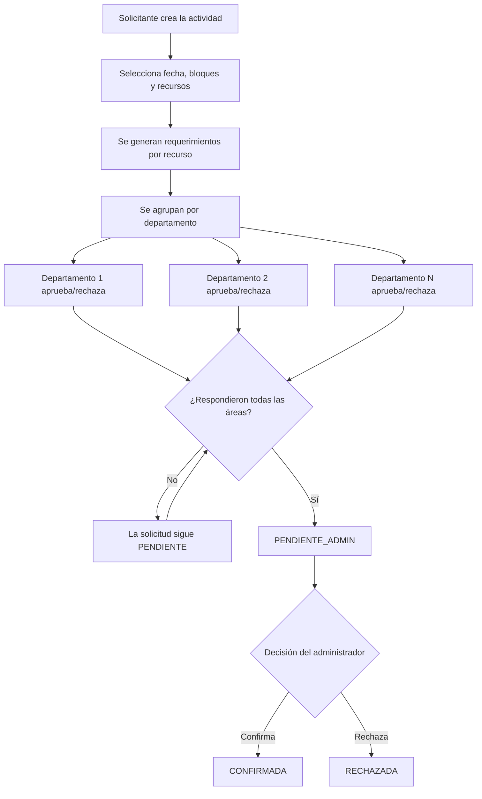

# VALI-DUOC · Validador de Actividades

Aplicación Android para gestionar la solicitud, validación y confirmación de actividades en **Duoc UC**, considerando los recursos de cada departamento involucrado.

El flujo principal es:

1. Un **solicitante** crea una actividad, indica fecha, bloques horarios y los recursos que necesita.
2. La solicitud se divide automáticamente según el **departamento dueño de cada recurso**.
3. Cada **departamento involucrado** recibe la petición y aprueba o rechaza únicamente sus recursos.
4. Cuando todas las áreas respondieron, el **administrador** revisa el resultado y decide si la actividad se realiza o no.
5. Cada departamento puede administrar el stock de sus propios recursos; el administrador puede hacerlo de forma global.

> Proyecto académico / prototipo funcional. Actualmente funciona de forma **local en el dispositivo**, sin backend ni autenticación real.

---

## Tabla de contenidos

- [Funcionalidades](#funcionalidades)
- [Roles y permisos](#roles-y-permisos)
- [Flujo de una solicitud](#flujo-de-una-solicitud)
- [Estados](#estados)
- [Reglas de negocio](#reglas-de-negocio)
- [Arquitectura](#arquitectura)
- [Tecnologías](#tecnologías)
- [Estructura del proyecto](#estructura-del-proyecto)
- [Modelo de datos](#modelo-de-datos)
- [Requisitos](#requisitos)
- [Instalación y ejecución](#instalación-y-ejecución)
- [Datos de prueba](#datos-de-prueba)
- [Pruebas](#pruebas)
- [Limitaciones y próximos pasos](#limitaciones-y-próximos-pasos)

---

## Funcionalidades

### Solicitante

- Inicio de sesión con correo institucional.
- Calendario de actividades y consulta de sus propias solicitudes.
- Creación de una solicitud mediante un formulario de 3 pasos:
  1. Nombre de la actividad, fecha y rango de bloques horarios.
  2. Selección de recursos e insumos, agrupados por departamento.
  3. Resumen, adjuntos y confirmación.
- Visualización del stock disponible según fecha y bloques seleccionados.
- Adjuntar imágenes o documentos (PDF/Word).
- Recibir notificaciones cuando su actividad es confirmada o rechazada.

### Validador de departamento

- Panel con las solicitudes que involucran recursos de **su departamento**.
- Aprobación o rechazo de la petición, con motivo obligatorio en caso de rechazo.
- Acceso únicamente a los ítems de su área, no a los de otros departamentos.
- Gestión del inventario de su área:
  - Crear recursos.
  - Editar el stock total.
  - Retirar recursos sin borrar el historial (desactivación lógica).
- Notificación al recibir una nueva solicitud para su área.

### Administrador

- Panel general con tres pestañas:
  - **Por Confirmar:** solicitudes que ya recibieron respuesta de todas las áreas.
  - **Agenda:** actividades confirmadas, con buscador por actividad o solicitante.
  - **Inventario Global:** recursos de todos los departamentos.
- Confirmación o rechazo final de la actividad.
- Edición de stock y creación de recursos en cualquier departamento.
- Revalidación de stock antes de confirmar definitivamente.
- También puede crear solicitudes desde el panel administrativo.
- Notificación cuando una actividad queda lista para su confirmación.

### General

- Notificaciones locales según el rol y el estado de las solicitudes.
- Persistencia local de datos con Room.
- Interfaz construida con Jetpack Compose y Material 3.
- Datos de demostración sembrados automáticamente en la primera ejecución.

---

## Roles y permisos

| Acción | Solicitante | Validador | Administrador |
|---|:---:|:---:|:---:|
| Crear solicitud de actividad | ✅ | — | ✅ |
| Ver sus propias solicitudes | ✅ | — | — |
| Ver solicitudes de su departamento | — | ✅ | — |
| Aprobar/rechazar recursos de su área | — | ✅ | — |
| Confirmar/rechazar la actividad completa | — | — | ✅ |
| Gestionar inventario de su departamento | — | ✅ | — |
| Gestionar inventario de todos los departamentos | — | — | ✅ |
| Ver agenda de actividades confirmadas | — | — | ✅ |

---

## Flujo de una solicitud



### Detalle

1. **Creación:** al confirmar el formulario, se valida la anticipación, el stock disponible y los adjuntos.
2. **Asignación por área:** cada recurso pertenece a un departamento. Los requerimientos se generan por recurso y el panel de cada validador filtra solo los de su área.
3. **Validación por área:** un departamento aprueba o rechaza sus requerimientos. Un rechazo requiere un motivo.
4. **Paso al administrador:** cuando ningún requerimiento queda `PENDIENTE`, la reserva cambia a `PENDIENTE_ADMIN`, sin importar si hubo aprobaciones o rechazos.
5. **Decisión final:** el administrador puede confirmar la actividad o rechazarla indicando un motivo. Al confirmar se vuelve a validar el stock contra las reservas ya confirmadas.

---

## Estados

### Estado de la reserva (`EstadoReserva`)

| Estado | Significado |
|---|---|
| `PENDIENTE` | En validación por uno o más departamentos. |
| `PENDIENTE_ADMIN` | Todas las áreas respondieron; espera la decisión final del administrador. |
| `CONFIRMADA` | Actividad aprobada oficialmente. |
| `RECHAZADA` | Actividad rechazada, con motivo registrado. |

### Estado del requerimiento (`EstadoRequerimiento`)

| Estado | Significado |
|---|---|
| `PENDIENTE` | El área aún no se pronuncia sobre ese recurso. |
| `APROBADO` | El área aprobó el uso del recurso. |
| `RECHAZADO` | El área rechazó el uso del recurso, con motivo. |

---

## Reglas de negocio

- **Solo correos institucionales:** se aceptan dominios `duoc.cl`, `duocuc.cl` y `profesor.duoc.cl`.
- **Bloques horarios:** existen 13 bloques oficiales, desde las 09:31 hasta las 19:00.
- **Anticipación mínima:** la actividad debe solicitarse con al menos **48 horas** de anticipación.
- **Anticipación ideal:** con **14 días o más** se considera una solicitud sin advertencia; entre 48 horas y 14 días se muestra una advertencia, pero se permite continuar.
- **Al menos un recurso:** no se puede enviar una solicitud sin recursos.
- **Stock:** se valida al crear la solicitud y se revalida al confirmar por el administrador.
- **Ocupación:** para calcular disponibilidad se descuentan las cantidades comprometidas en reservas **confirmadas** para la misma fecha y bloques.
- **Rango de bloques continuo:** el bloque final debe ser mayor o igual al inicial.
- **Adjuntos:** máximo **20 archivos**, **5 MB por archivo**. Documentos permitidos: PDF, DOC y DOCX; imágenes de cualquier formato de imagen.
- **Rechazo con motivo:** tanto las áreas como el administrador deben indicar un motivo al rechazar.
- **Recursos retirados:** se desactivan lógicamente (`activo = false`) para conservar el historial de reservas.

---

## Arquitectura

La aplicación sigue una arquitectura por capas, inspirada en **MVVM**, con flujo de datos unidireccional mediante `StateFlow`:

```text
Compose UI  →  ViewModel  →  Repository  →  Room DAO  →  SQLite
     ↑              │
     └── StateFlow ─┘
```

- **UI:** Jetpack Compose + Material 3, organizada por pantallas y componentes reutilizables.
- **Presentación:** un `ViewModel` por rol/flujo (`AuthViewModel`, `SolicitanteViewModel`, `ValidadorViewModel`, `AdminViewModel`).
- **Dominio:** modelos, reglas de anticipación y bloques horarios.
- **Datos:** repositorios que encapsulan transacciones y DAOs de Room.
- **Inyección de dependencias:** manual, a través del objeto `AppContainer`.
- **Navegación:** Navigation Compose con rutas por rol.

### Decisiones relevantes

- Las operaciones críticas (`crearReserva`, `resolverArea`, `confirmarPorAdmin`) se ejecutan dentro de transacciones de Room.
- La validación de negocio se repite en el repositorio y no se confía solo en la UI.
- La base de datos es local. `fallbackToDestructiveMigration()` está pensado **solo para desarrollo**.
- Las notificaciones se generan observando los `Flow` de reservas, con deduplicación mediante `SharedPreferences`.

---

## Tecnologías

| Área | Tecnología |
|---|---|
| Lenguaje | Kotlin 2.2.10 |
| UI | Jetpack Compose + Material 3 |
| Navegación | Navigation Compose |
| Persistencia | Room 2.8.4 (KSP) |
| Asincronía | Coroutines + Flow |
| Arquitectura | MVVM + Repository |
| Notificaciones | NotificationCompat + canales de Android |
| Build | Gradle + Android Gradle Plugin 9.4.1 |
| SDK | `minSdk 30`, `targetSdk 37`, `compileSdk 37` |
| Java | Java 11 (source/target) |

---

## Estructura del proyecto

```text
validador-actividades-duoc/
├── app/
│   ├── build.gradle.kts
│   └── src/
│       ├── main/
│       │   ├── AndroidManifest.xml
│       │   ├── java/com/validador_actividades_duoc/
│       │   │   ├── MainActivity.kt
│       │   │   ├── data/
│       │   │   │   ├── AdjuntoStorage.kt
│       │   │   │   ├── local/
│       │   │   │   │   ├── AppContainer.kt
│       │   │   │   │   ├── AppDataBase.kt
│       │   │   │   │   ├── Converters.kt
│       │   │   │   │   ├── dao/
│       │   │   │   │   └── entity/
│       │   │   │   └── repository/
│       │   │   │       ├── InventarioRepository.kt
│       │   │   │       └── ReservaRepository.kt
│       │   │   ├── domain/
│       │   │   │   ├── model/        # roles, estados, departamentos, adjuntos
│       │   │   │   └── util/         # bloques horarios y reglas de negocio
│       │   │   ├── notifications/
│       │   │   │   ├── NotificacionesHelper.kt
│       │   │   │   └── NotificadorEventos.kt
│       │   │   └── ui/
│       │   │       ├── components/
│       │   │       ├── navigation/
│       │   │       ├── screens/
│       │   │       │   ├── admin/
│       │   │       │   ├── auth/
│       │   │       │   ├── solicitante/
│       │   │       │   └── validador/
│       │   │       └── theme/
│       │   └── res/
│       ├── test/
│       └── androidTest/
├── gradle/
│   └── libs.versions.toml
├── build.gradle.kts
├── settings.gradle.kts
├── gradle.properties
└── README.md
```

---

## Modelo de datos

La base de datos local se llama `validador_duoc_db` y usa Room con cinco entidades:

| Tabla | Campos principales | Descripción |
|---|---|---|
| `usuarios` | `id`, `correo`, `nombre`, `rol`, `departamento` | Usuarios de la aplicación. El departamento solo aplica a validadores. |
| `reservas` | `id`, `solicitanteId`, `nombreActividad`, `fecha`, `bloqueInicio`, `bloqueFin`, `estado`, `motivoRechazo`, `fechaCreacion` | Actividad solicitada. |
| `requerimientos` | `id`, `reservaId`, `recursoId`, `cantidadSolicitada`, `estadoValidacion`, `motivoRechazo`, `validadorId`, `fechaResolucion` | Recurso pedido dentro de una reserva y su validación por área. |
| `recursos_inventario` | `id`, `departamento`, `nombreItem`, `stockTotal`, `activo` | Catálogo de recursos por departamento. |
| `adjuntos` | `id`, `reservaId`, `tipo`, `nombreArchivo`, `rutaLocal`, `mimeType`, `tamanoBytes` | Archivos adjuntos de la solicitud. |

### Relaciones

```text
usuarios 1 ─── N reservas
reservas 1 ─── N requerimientos
reservas 1 ─── N adjuntos
recursos_inventario 1 ─── N requerimientos
```

- `reservas.solicitanteId` → `usuarios.id` con borrado en cascada.
- `requerimientos.reservaId` → `reservas.id` con borrado en cascada.
- `requerimientos.recursoId` → `recursos_inventario.id` con borrado restringido.
- `adjuntos.reservaId` → `reservas.id` con borrado en cascada.

---

## Requisitos

- **Android Studio** con soporte para AGP 9.x.
- **JDK 17 o superior**.
- **Android SDK 37** instalado.
- Emulador o dispositivo físico con **Android 11 (API 30) o superior**.
- Conexión a internet la primera vez para descargar dependencias de Gradle.

> El proyecto no necesita backend, base de datos remota ni variables de entorno. Android Studio genera `local.properties` con la ruta del SDK.

---

## Instalación y ejecución

1. Clona el repositorio:

   ```bash
   git clone <URL_DEL_REPOSITORIO>
   cd validador-actividades-duoc
   ```

2. Abre el proyecto en Android Studio.

3. Espera la sincronización de Gradle. Si es necesario, ejecuta:

   ```bash
   # Linux / macOS
   ./gradlew build

   # Windows
   .\gradlew.bat build
   ```

4. Selecciona un emulador o dispositivo y presiona **Run ▶**.

5. En la primera ejecución se crean automáticamente los usuarios, recursos y una solicitud de ejemplo.

### Compilar el APK de depuración

```bash
# Linux / macOS
./gradlew assembleDebug

# Windows
.\gradlew.bat assembleDebug
```

El APK se genera en:

```text
app/build/outputs/apk/debug/app-debug.apk
```

Instalación por ADB:

```bash
adb install -r app/build/outputs/apk/debug/app-debug.apk
```

### Reiniciar los datos de prueba

Los datos solo se siembran si la tabla de usuarios está vacía. Para volver a generarlos, borra los datos de la app desde:

```text
Ajustes → Aplicaciones → validador-actividades-duoc → Almacenamiento → Borrar datos
```

También puedes desinstalar y volver a instalar la aplicación.

---

## Datos de prueba

La app incluye un inicio de sesión simplificado: **solo se ingresa el correo institucional**, sin contraseña. Si el correo no existe, se crea automáticamente como `SOLICITANTE`.

| Rol | Correo | Departamento |
|---|---|---|
| Administrador | `admin@duoc.cl` | — |
| Solicitante | `profesor@duoc.cl` | — |
| Validador | `auxiliares@duoc.cl` | Servicios Auxiliares |
| Validador | `porteria@duoc.cl` | Portería y Accesos |
| Validador | `digitales@duoc.cl` | Servicios Digitales |
| Validador | `comunicacion@duoc.cl` | Comunicaciones |

### Recursos iniciales

| Departamento | Recursos |
|---|---|
| Servicios Auxiliares | Mesas plegables (20), Toldos (3) |
| Portería y Accesos | Guardias de seguridad (6), Estacionamiento para proveedor (5) |
| Servicios Digitales | Micrófonos inalámbricos (6), Proyectores (4), Computadores (3) |
| Comunicaciones | Registro de fotos y video (2), Difusión en RSS (5) |

Además se crea la actividad de ejemplo **“Encuentro de Innovación (DEMO)”** para probar los paneles sin crear una solicitud manualmente.

### Recomendación para probar el flujo completo

1. Ingresa como `profesor@duoc.cl` y crea una solicitud con recursos de varios departamentos.
2. Cierra sesión e ingresa como cada validador involucrado para aprobar o rechazar sus recursos.
3. Ingresa como `admin@duoc.cl`, revisa la pestaña **Por Confirmar** y confirma o rechaza la actividad.
4. Vuelve a entrar como solicitante para ver el estado final y la notificación.

---

## Pruebas

El proyecto incluye la estructura de pruebas de Android, aunque actualmente solo contiene las pruebas de ejemplo.

```bash
# Pruebas unitarias locales
./gradlew test

# Pruebas instrumentadas (requiere emulador o dispositivo)
./gradlew connectedAndroidTest
```

En Windows:

```powershell
.\gradlew.bat test
.\gradlew.bat connectedAndroidTest
```

---

## Limitaciones y próximos pasos

Al tratarse de un prototipo local, existen aspectos pendientes para una versión productiva:

- **Autenticación real:** actualmente no hay contraseña, tokens ni sesión persistente; el acceso es solo por correo institucional.
- **Backend compartido:** la base de datos vive en el dispositivo, por lo que no hay sincronización entre usuarios ni dispositivos.
- **Notificaciones push:** las notificaciones son locales y dependen de que la app esté en ejecución.
- **Migraciones de Room:** se usa `fallbackToDestructiveMigration()`; en producción deben implementarse migraciones formales.
- **Gestión de usuarios:** no existe una pantalla para administrar roles o departamentos.
- **Auditoría y reportes:** no hay historial detallado de cambios ni exportación de información.
- **Cobertura de pruebas:** faltan pruebas unitarias de reglas de negocio y pruebas de interfaz para los flujos principales.
- **Seguridad:** los adjuntos se guardan en el almacenamiento privado de la app, pero no se cifran ni se respaldan en un servidor.

---

